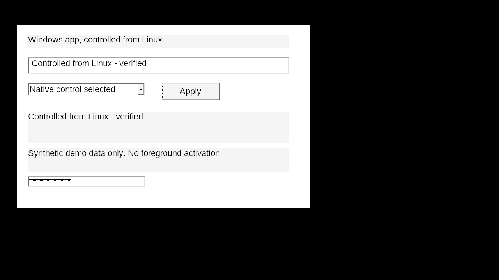

# linux-windows-apps

让 AI 在 Linux 上安装、启动和操作 Windows 软件的技能。支持明确指定的 Wine/Bottles 环境、真实 Win32 控件读取，以及独立后台桌面，避免抢占用户鼠标和前台窗口。



## 能做什么

- EXE / MSI 安装、启动，记录安装包 SHA-256；不会默认使用 `~/.wine`。
- 获取窗口、控件、进程 ID 和进程创建时间；操作前检查句柄是否过期。
- 对普通 Edit / RichEdit 输入、Button 点击、ComboBox 选择，读取原生菜单。
- 创建带 Xauthority 的 Cage + Xwayland 或 Xvfb 后台桌面，只截取本任务的私有桌面。
- 密码框在快照中隐藏，并拒绝用命令行填入；消息操作有超时。

这不是 Windows 虚拟机，也不保证任何 Windows 软件都能运行。WebView2、Electron、自绘界面和 Office 插件需要各自验证。Wine / Bottles **不是安全沙箱**，不要运行不可信安装包。

## 安装技能

```sh
git clone https://github.com/LIghtJUNction/linux-windows-apps.git   ~/.codex/skills/linux-windows-apps
```

在支持 `SKILL.md` 的 Agent 中使用：

> 使用 $linux-windows-apps，在独立环境安装这个 Windows 软件，后台操作，不影响我的桌面。先检查现有环境，保存真实截图和操作结果。

脚本也可独立使用，无需 Agent。Python 3.11+；构建控件 helper 需要 MinGW-w64。后台桌面需要 `xauth`、`xdotool` 和 Cage/Xwayland 或 Xvfb；截图需要 ImageMagick `import`。脚本不自动修改系统或安装依赖。

## 快速开始

完整命令见 [操作说明](references/operation.md)。所有路径均由操作者明确选择；Bottles 配置、依赖覆盖和 DLL overrides 不会被脚本自动继承。实测优先直接调用 host runner；Flatpak 并行任务存在共享生命周期风险，见操作说明。

```sh
python3 scripts/winapp.py doctor
python3 scripts/winapp.py build-helper --output .local/winui.exe
python3 scripts/winapp.py --display :42 desktop --state .local/display-42
# 另一个终端：使用 ready.json 中的 display / xauthority
python3 scripts/winapp.py --prefix /path/to/prefix --wine /path/to/runner/bin/wine   --display :42 --xauthority .local/display-42/Xauthority   ui snapshot --helper .local/winui.exe
```

运行后台桌面的终端需保持存活。结束时先通过软件界面保存和关闭，再在对应桌面终端按 Ctrl-C；不要关闭其他任务的 Wine 服务。

## 验证与边界

[验证记录](docs/validation.md)区分实际运行结果与未验证项目。[兼容性诊断](references/compatibility.md)包含中文方框、WebView2、黑屏截图和控件不可见的处理方法。

```sh
python3 -m unittest discover -s tests -v
python3 scripts/winapp.py build-helper --arch 32 --output .local/winui32.exe
python3 scripts/winapp.py build-helper --arch 64 --output .local/winui64.exe
```

本仓库只包含自己的源码、文档和合成演示截图，不分发第三方安装包、运行库、授权信息或个人资料。MIT 许可证；第三方软件遵循各自许可证。

发布记录：[v0.1.0](https://github.com/LIghtJUNction/linux-windows-apps/releases/tag/v0.1.0) · [X 实测演示帖](https://x.com/LIghtJUNction_x/status/2110815125137772608)
